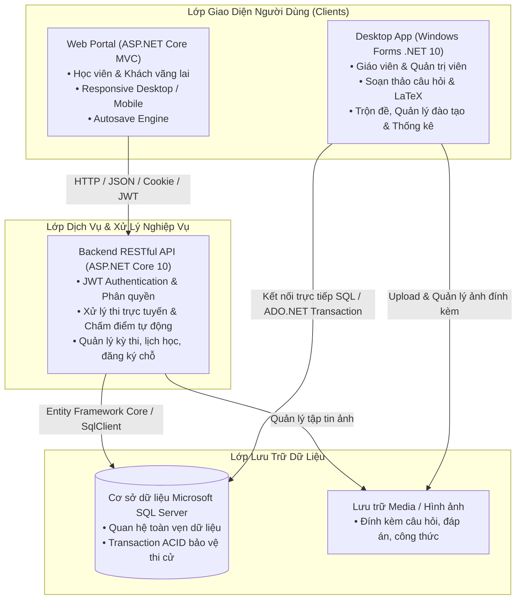
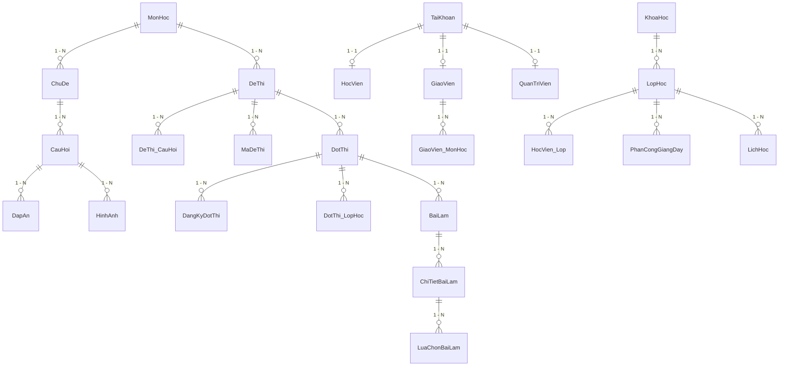

# TỔNG HỢP TOÀN BỘ CHỨC NĂNG HỆ THỐNG QUẢN LÝ VÀ THI TRẮC NGHIỆM TRỰC TUYẾN (QLThiTN)

> **Dự án**: Hệ thống Quản lý và Thi trắc nghiệm trực tuyến THPT Quốc gia  
> **Kiến trúc**: Đa nền tảng gồm **Web Portal** (Học viên & Khách), **Desktop Application** (Giáo viên & Quản trị viên), và **Backend RESTful API Service**  
> **Công nghệ nền tảng**: C#, .NET 10, ASP.NET Core MVC, ASP.NET Core Web API, Windows Forms, SQL Server, Entity Framework Core, Dapper/ADO.NET, Microsoft Edge WebView2, KaTeX / MathJax LaTeX.

---

## MỤC LỤC
1. [Kiến trúc tổng thể hệ thống](#1-kiến-trúc-tổng-thể-hệ-thống)
2. [Ma trận phân quyền vai trò (RBAC)](#2-ma-trận-phân-quyền-vai-trò-rbac)
3. [Phân hệ Web Portal (Dành cho Học viên & Khách)](#3-phân-hệ-web-portal-dành-cho-học-viên--khách)
4. [Phân hệ Desktop App - Windows Forms (Dành cho Giáo viên & Quản trị viên)](#4-phân-hệ-desktop-app---windows-forms-dành-cho-giáo-viên--quản-trị-viên)
5. [Phân hệ Backend RESTful API & Dịch vụ bảo mật](#5-phân-hệ-backend-restful-api--dịch-vụ-bảo-mật)
6. [Mô hình cơ sở dữ liệu & Thực thể nghiệp vụ](#6-mô-hình-cơ-sở-dữ-liệu--thực-thể-nghiệp-vụ)
7. [Các cơ chế kỹ thuật & Nghiệp vụ nổi bật](#7-các-cơ-chế-kỹ-thuật--nghiệp-vụ-nổi-bật)

---

## 1. KIẾN TRÚC TỔNG THỂ HỆ THỐNG

Hệ thống được thiết kế theo mô hình phân tầng hướng dịch vụ (Service-Oriented / Multi-Tier Architecture), phân tách độc lập giữa giao diện người dùng và lớp dịch vụ dữ liệu:



---

## 2. MA TRẬN PHÂN QUYỀN VAI TRÒ (RBAC)

Hệ thống quản lý 4 nhóm đối tượng chính với ranh giới quyền được kiểm soát chặt chẽ ở cả cấp giao diện (UI) và tầng dữ liệu (Service & API):

| Nhóm chức năng | Khách (Vãng lai) | Học viên (Miễn phí) | Học viên (VIP / Đóng phí) | Giáo viên | Quản trị viên (Admin) |
|---|:---:|:---:|:---:|:---:|:---:|
| **Xem trang chủ, kho đề công khai, lịch thi** | ✅ | ✅ | ✅ | ✅ | ✅ |
| **Đăng ký tài khoản, đăng nhập Google / Email** | ✅ | ✅ | ✅ | — | — |
| **Tham gia thi thử các đề mở công khai (Miễn phí)** | — | ✅ | ✅ | — | — |
| **Tham gia đề thi chuyên sâu / VIP tính phí** | — | — | ✅ | — | — |
| **Đăng ký / Hủy đăng ký đợt thi giới hạn chỗ** | — | ✅ | ✅ | — | — |
| **Thi trực tuyến: đếm giờ, lưu tạm, nộp bài, xem điểm** | — | ✅ | ✅ | — | — |
| **Xem lịch sử bài làm & Biểu đồ tiến độ cá nhân** | — | ✅ | ✅ | — | — |
| **Xem thời khóa biểu / Lịch học các lớp tham gia** | — | ✅ | ✅ | — | — |
| **Quản lý câu hỏi (Môn học được phân công & do mình tạo)** | — | — | — | ✅ | ✅ |
| **Import câu hỏi hàng loạt (Excel, Word, Text, ZIP kèm ảnh)** | — | — | — | ✅ | ✅ |
| **Tạo đề thi (Thủ công / Tự động ma trận / Chuẩn THPTQG)** | — | — | — | — | ✅ |
| **Hoán vị / Trộn đề sinh mã đề thi (101, 102...)** | — | — | — | — | ✅ |
| **Mở / Đóng đợt thi, cấu hình phạm vi lớp, công bố điểm** | — | — | — | — | ✅ |
| **Xem báo cáo, phổ điểm, thống kê chất lượng câu hỏi** | — | — | — | ✅ *(Phạm vi môn)* | ✅ *(Toàn hệ thống)* |
| **Quản lý khóa học, lớp học, xếp học viên vào lớp** | — | — | — | — | ✅ |
| **Phân công giảng dạy (Gán GV - Môn - Lớp)** | — | — | — | — | ✅ |
| **Quản lý lịch học, phòng học (Chống trùng phòng/giờ)** | — | — | — | — | ✅ |
| **Quản lý tài khoản: Thêm, sửa, khóa/mở khóa, reset mật khẩu** | — | — | — | — | ✅ |
| **Nâng gói tài khoản (Miễn phí ↔ VIP)** | — | — | — | — | ✅ |
| **Sao lưu (Backup) & Phục hồi (Restore) Cơ sở dữ liệu** | — | — | — | — | ✅ |

---

## 3. PHÂN HỆ WEB PORTAL (DÀNH CHO HỌC VIÊN & KHÁCH)

Giao diện Web được xây dựng bằng **ASP.NET Core MVC**, thiết kế hiện đại, tương thích hoàn toàn trên cả máy tính bàn (Desktop) và thiết bị di động (Mobile Responsive), hỗ trợ chuyển đổi chế độ Sáng / Tối (Light / Dark theme).

### 3.1. Trang chủ & Giới thiệu (`HomeController`)
- **Hero Banner tương tác**: Hiển thị thông điệp đón tiếp theo trạng thái đăng nhập, số liệu thống kê thời gian thực (tổng câu hỏi trong ngân hàng, tổng lượt làm bài, số đợt thi đang mở).
- **Thống kê tổng quan**: Số lượng kỳ thi, đợt thi đang diễn ra, số bài thi đã hoàn thành và điểm trung bình toàn hệ thống.
- **Danh sách đề thi mới nhất**: Hiển thị thẻ đề thi trực quan kèm số lượt thi, điểm trung bình và nhãn đề Miễn phí / VIP.
- **Cảm nhận học viên (Testimonials)** & Quy trình 3 bước tham gia thi trực tuyến.

### 3.2. Quản lý Tài khoản & Xác thực (`AccountController`)
- **Đăng ký tài khoản mới**:
  - Kiểm tra tính hợp lệ của Tên đăng nhập, Email và độ dài Mật khẩu tối thiểu 6 ký tự.
  - Gửi email xác thực kèm mã kích hoạt (Token) bảo mật.
  - Tự động gắn quyền `HocVien` và phân loại học viên ban đầu là `TuDo` (Gói `MienPhi`).
- **Đăng nhập hệ thống**:
  - Đăng nhập bằng Tên đăng nhập / Email và Mật khẩu.
  - Hỗ trợ tùy chọn **"Ghi nhớ đăng nhập" (Remember Me)** lưu phiên đăng nhập lâu dài an toàn qua Cookie.
  - Tự động chặn các tài khoản có trạng thái `BiKhoa`.
- **Đăng nhập bằng Google (OAuth2 Google Sign-In)**:
  - Cho phép học viên đăng nhập nhanh bằng tài khoản Google.
  - Tự động đồng bộ thông tin và tạo hồ sơ học viên tương ứng nếu đăng nhập lần đầu.
- **Hồ sơ cá nhân (Profile)**:
  - Xem thông tin tài khoản, họ tên, email, ngày đăng ký, loại gói tài khoản (`MienPhi` hoặc `DongPhi/VIP`).
  - Cập nhật thông tin họ tên, email và đổi mật khẩu bảo mật.
  - Điều hướng và hiển thị nhãn trạng thái VIP.

### 3.3. Lịch thi & Đăng ký phòng thi (`ExamController/Schedule`)
- **Danh sách đợt thi**: Hiển thị tất cả các đợt thi đang mở hoặc sắp diễn ra, phân loại theo môn học.
- **Đăng ký / Hủy đăng ký giữ chỗ**:
  - Học viên đăng ký tham gia các đợt thi có giới hạn số lượng (`GioiHanSoLuong`).
  - Hủy đăng ký khi không tham gia để giải phóng chỗ cho thí sinh khác.
  - Cơ chế đồng thời (Concurrency Lock): Chặn vượt sĩ số khi nhiều thí sinh đăng ký cùng một thời điểm.
- **Kiểm soát điều kiện vào thi**:
  - Kiểm tra trạng thái mở cổng: Chỉ cho phép vào phòng thi khi đợt thi đang ở trạng thái `DangMo` và trong khung giờ quy định.
  - Kiểm tra gói tài khoản: Chặn tài khoản `MienPhi` vào các đợt thi tính phí `VIP` (trả về mã 403).
  - Kiểm tra phạm vi lớp: Đợt thi có phạm vi `TheoLop` chỉ cho phép học viên đã được xếp vào lớp tương ứng tham gia.

### 3.4. Thư viện kho đề thi (`ExamController/KhoDe`)
- **Tra cứu và tìm kiếm đề thi**: Tìm kiếm theo tên đề, lọc theo môn học, sắp xếp theo độ phổ biến, lượt thi nhiều nhất hoặc mới nhất.
- **Xem chi tiết đề thi**: Số lượng câu hỏi, thời gian làm bài, cấu trúc loại đề, phân loại Miễn phí / VIP.

### 3.5. Phòng thi trực tuyến thời gian thực (`ExamController/Taking`)
- **Môi trường thi tập trung, chống phân tâm**:
  - Giao diện làm bài toàn màn hình, thanh tiến độ làm bài trực quan.
  - Đồng hồ đếm ngược thời gian thực (Countdown Timer), cảnh báo khi sắp hết giờ.
- **Hiển thị đề thi đa phương thức**:
  - Hiển thị công thức Toán, Lý, Hóa bằng **LaTeX / KaTeX** sắc nét.
  - Hiển thị hình ảnh minh họa chất lượng cao ở cả câu hỏi và các phương án trả lời.
  - Hỗ trợ đầy đủ 3 dạng thức câu hỏi:
    1. *Trắc nghiệm 4 lựa chọn* (A, B, C, D).
    2. *Đúng / Sai đa mệnh đề* (chọn Đúng/Sai cho từng ý riêng biệt).
    3. *Trả lời ngắn / Điền đáp số* (hỗ trợ nhập số nguyên, số thập phân có dấu chấm/phẩy).
- **Cơ chế Lưu tạm tự động & Kháng lỗi mạng (Autosave Engine)**:
  - Tự động lưu bài làm ngầm lên máy chủ mỗi khi học viên chọn đáp án.
  - Hỗ trợ lưu trữ cục bộ (`localStorage`) khi mạng chập chờn hoặc mất kết nối.
  - Tự động đồng bộ và phục hồi đáp án lên máy chủ ngay khi có mạng trở lại.
- **Đánh dấu câu hỏi cần xem lại (Flagging)**: Giúp thí sinh ghim lại các câu phân vân để kiểm tra trước khi nộp.
- **Nộp bài & Thu bài tự động**:
  - Cho phép thí sinh chủ động nộp bài khi hoàn thành.
  - **Tự động thu bài và đóng phiên thi khi đồng hồ về 0**, bảo vệ nguyên vẹn bài làm của học viên.
  - Chống nộp bài trùng lặp (Idempotent submission): Nhiều lượt bấm nộp đồng thời chỉ xử lý đúng một bài làm duy nhất.

### 3.6. Kết quả thi & Phổ điểm (`ExamController/Result`)
- **Xem điểm số tức thì**: Điểm tổng kết theo thang điểm 10, số câu đúng, số câu sai, thời gian làm bài thực tế.
- **Chính sách bảo mật công bố điểm**:
  - Nếu đợt thi bật `CongBoDiemSom`: Hiển thị chi tiết từng câu, đáp án đúng của hệ thống và lời giải thích.
  - Nếu đợt thi tắt công bố sớm: Che điểm và ẩn toàn bộ đáp án chi tiết cho đến khi toàn bộ đợt thi kết thúc.

### 3.7. Lịch sử bài làm & Biểu đồ tiến độ (`ExamController/History`)
- **Lịch sử toàn bộ bài thi**: Thống kê danh sách các bài thi đã làm, thời gian bắt đầu, thời gian nộp, số điểm đạt được và trạng thái hoàn thành.
- **Biểu đồ trực quan hóa kết quả**: Biểu đồ đường (Line chart) theo dõi sự tiến bộ điểm số qua từng lần thi của học viên.

### 3.8. Thời khóa biểu học tập (`ExamController/LearningSchedule`)
- Hiển thị lịch học các lớp mà học viên được ghi danh (ngày giờ, phòng học, môn học, giáo viên phụ trách).
- Lọc lịch học theo lớp và khoảng thời gian (Từ ngày - Đến ngày).

---

## 4. PHÂN HỆ DESKTOP APP - WINDOWS FORMS (DÀNH CHO GIÁO VIÊN & QUẢN TRỊ VIÊN)

Ứng dụng Windows Forms (.NET 10) đóng vai trò trung tâm điều hành dành riêng cho nhân viên, cán bộ đào tạo, giáo viên và quản trị viên hệ thống.

### 4.1. Xác thực & Điều hướng giao diện theo vai trò (`frmLogin`, `frmMain`)
- Đăng nhập xác thực tài khoản nội bộ (`GiaoVien` hoặc `QuanTriVien`).
- Thanh điều hướng (Sidebar) tự động co giãn và phân chia nhóm tính năng rõ ràng theo quyền hạn:
  - **Giáo viên**: Ngân hàng câu hỏi, Thống kê đợt thi theo môn được phân công, Đổi mật khẩu.
  - **Quản trị viên**: Toàn quyền truy cập Quản trị tài khoản, Quản lý đào tạo, Quản lý đề & đợt thi, Sao lưu & Phục hồi CSDL, Báo cáo toàn trường.

### 4.2. Quản lý Ngân hàng câu hỏi (`frmQuestions`, `frmQuestionEdit`)
- **Bộ lọc đa tiêu chí**: Lọc theo Môn học, Chủ đề, Mức độ khó (Nhận biết, Thông hiểu, Vận dụng, Vận dụng cao), Loại câu hỏi và trạng thái hoạt động.
- **Biên soạn câu hỏi chuyên sâu**:
  - Hỗ trợ công thức toán học và ký hiệu khoa học chuẩn LaTeX.
  - Hỗ trợ đính kèm hình ảnh minh họa cho câu hỏi và từng phương án đáp án.
  - Hỗ trợ cả 3 dạng thức câu hỏi: Trắc nghiệm 4 lựa chọn, Đúng/Sai đa mệnh đề, Điền đáp án ngắn.
  - Tích hợp khung **Xem trước thời gian thực (Real-time Preview)** bằng Microsoft Edge WebView2, render công thức LaTeX và hình ảnh hệt như lúc thí sinh làm bài thi.
- **Kiểm soát phạm vi và quyền sở hữu**:
  - Giáo viên chỉ được xem và thêm câu hỏi vào các môn học mình được phân công giảng dạy.
  - Giáo viên chỉ được chỉnh sửa hoặc xóa câu hỏi do chính mình biên soạn, bảo vệ dữ liệu giữa các đồng nghiệp.
  - Chặn xóa các câu hỏi đã được đưa vào đề thi của các kỳ thi đã diễn ra (bảo toàn dữ liệu lịch sử).

### 4.3. Nhập câu hỏi hàng loạt từ file (`frmQuestionImport`)
- **Hỗ trợ đa dạng định dạng dữ liệu đầu vào**:
  - File Excel (`.xlsx`) theo biểu mẫu chuẩn.
  - File tài liệu Word (`.docx`).
  - File văn bản thuần phân cách tab / pipe (`.txt`, `.csv`).
  - **Gói nén ZIP (`.zip`)**: Chứa file cấu trúc dữ liệu kèm toàn bộ thư mục hình ảnh minh họa đính kèm câu hỏi và đáp án.
- **Kiểm tra và tiền xử lý thông minh (Validation & Preview)**:
  - Kiểm tra tính hợp lệ từng dòng: Thiếu đáp án đúng, sai định dạng mệnh đề Đúng/Sai, thiếu hình ảnh tham chiếu.
  - Cho phép chọn/bỏ chọn từng dòng câu hỏi trước khi nạp vào CSDL.
  - Cơ chế **Rollback Transaction**: Đảm bảo nếu quá trình lưu gặp sự cố, hệ thống sẽ khôi phục nguyên trạng, không để lại hình ảnh rác hay dữ liệu lỗi.
  - Chống tấn công khai thác đường dẫn (Zip Slip / Path Traversal) khi giải nén gói ảnh.

### 4.4. Quản lý Đề thi & Trộn đề thi (`frmExams`, `frmTronDe`)
- **Tạo đề thi thủ công (`frmTaoDeThuCong`)**: Cho phép chọn từng câu hỏi từ ngân hàng để đưa vào đề thi.
- **Tạo đề thi tự động theo ma trận cấu trúc (`frmTaoDeTuDong`)**:
  - Cấu hình ma trận đề: Chọn môn học, chủ đề, số lượng câu theo từng cấp độ nhận thức (Nhận biết, Thông hiểu, Vận dụng).
  - Thuật toán tự động quét ngân hàng và bốc ngẫu nhiên câu hỏi đúng theo ma trận quy định.
- **Tạo đề chuẩn cấu trúc THPT Quốc gia 2025 (`frmTaoDeTHPTQG`)**:
  - Tự động phân bổ đúng tỷ lệ: Phần I (Trắc nghiệm nhiều lựa chọn), Phần II (Đúng / Sai đa mệnh đề), Phần III (Trả lời ngắn).
- **Hoán vị & Trộn đề sinh nhiều mã đề (`frmTronDe`)**:
  - Tự động xáo trộn ngẫu nhiên thứ tự các câu hỏi trong từng phần của đề thi.
  - **Thuật toán ghim đáp án thông minh (Smart Anchor Pinning)**: Tự động phát hiện các phương án phụ thuộc thứ tự (như *"Tất cả các đáp án trên đều đúng/sai"*, *"Cả A và B đều đúng"*, *"Không có đáp án nào đúng"*...) và **luôn cố định ở vị trí cuối cùng (D)**, chỉ xáo trộn các phương án A, B, C còn lại.
  - Tùy chọn bật/tắt linh hoạt bằng checkbox trên giao diện màn hình trộn đề.
  - Sinh hàng loạt mã đề con khác nhau (101, 102, 103, 104...) kèm ma trận đáp án tương ứng.
- **Bảo toàn đề thi**: Chặn xóa đề thi đã có học viên tham gia làm bài, yêu cầu đóng đợt thi thay vì xóa dữ liệu.

### 4.5. Quản lý Đợt thi / Kỳ thi (`frmDotThiEdit`)
- Thiết lập tên đợt thi, liên kết với đề thi gốc và các mã đề hoán vị.
- Cài đặt thời gian mở cổng và đóng cổng thi chính xác đến từng phút.
- Thiết lập thời lượng làm bài (phút), số lần thi tối đa cho phép của mỗi học viên.
- Phân loại phạm vi kỳ thi: **Toàn trường** (mọi học viên đều được thi) hoặc **Theo lớp** (chỉ học viên thuộc danh sách lớp được chỉ định).
- Cài đặt số lượng đăng ký tối đa (giới hạn phòng thi).
- Cấu hình hiển thị điểm: Công bố điểm ngay sau khi nộp hoặc che điểm cho đến khi kết thúc đợt thi.

### 4.6. Báo cáo & Thống kê kết quả thi (`frmStatistics`)
- **Thống kê đợt thi**:
  - Đọc danh sách kết quả thí sinh: Điểm số, lần thi, thời gian bắt đầu, thời gian nộp bài, trạng thái bài làm.
  - Biểu đồ phổ điểm trực quan (`BarChartControl`), phân bổ điểm từ 0 đến 10.
  - Tính toán các chỉ số: Điểm cao nhất, điểm thấp nhất, điểm trung bình, độ lệch chuẩn, tỷ lệ học viên đạt yêu cầu.
- **Phân tích chất lượng câu hỏi (Item Analysis)**:
  - Thống kê tỷ lệ phần trăm thí sinh chọn từng phương án A, B, C, D của mỗi câu.
  - Tính toán độ khó thực tế của câu hỏi dựa trên kết quả làm bài của thí sinh.
  - Giúp giáo viên phát hiện các câu hỏi quá khó, quá dễ hoặc có phương án gây nhiễu kém chất lượng.
- **Xuất báo cáo**: Xuất toàn bộ bảng điểm và kết quả phân tích sang file Excel (.xlsx).

### 4.7. Quản trị Đào tạo (`frmDaoTao`)
- **Quản lý Khóa học (`frmKhoaHocEdit`)**: Tạo và quản lý các khóa học (Toán 12 Luyện thi, Lý cấp tốc...), ngày bắt đầu, ngày kết thúc. Ràng buộc ngày kết thúc phải sau ngày bắt đầu.
- **Quản lý Lớp học (`frmLopHocEdit`)**: Tạo các lớp học trực thuộc khóa học. Ràng buộc an toàn: Không thể xóa lớp học nếu lớp còn học viên, còn phân công hoặc còn lịch học.
- **Xếp học viên vào lớp**: Ghi danh học viên vào lớp học tương ứng, quản lý danh sách thành viên của lớp.
- **Phân công giảng dạy (`frmPhanCongEdit`)**:
  - Phân công giáo viên phụ trách môn học cho từng lớp cụ thể.
  - Tự động đồng bộ quyền hạn giảng dạy môn học cho giáo viên (`GiaoVien_MonHoc`) trong Transaction an toàn, chống tạo phân công trùng lặp.
- **Quản lý Lịch học & Phòng học (`frmLichHocEdit`)**:
  - Lập thời khóa biểu: Thứ, ngày học, ca học (từ giờ đến giờ), phòng học.
  - **Cơ chế chống xung đột (Conflict Prevention)**: Tự động kiểm tra và chặn lịch học nếu bị trùng phòng học hoặc trùng thời gian của lớp học khác.

### 4.8. Quản trị Tài khoản người dùng (`frmAccounts`, `frmAccountEdit`)
- Xem danh sách toàn bộ tài khoản hệ thống (Quản trị viên, Giáo viên, Học viên).
- Thêm mới tài khoản: Kiểm tra hợp lệ Tên đăng nhập, định dạng Email, độ dài Họ tên, mã hóa mật khẩu bảo mật.
- Khóa / Kích hoạt tài khoản: Ngăn chặn truy cập tức thì đối với tài khoản bị khóa.
- **Bảo vệ tài khoản quản trị**: Chặn quản trị viên tự khóa tài khoản của chính mình khi đang đăng nhập.
- Nâng cấp gói học viên: Chuyển đổi trạng thái học viên giữa gói `MienPhi` và `DongPhi` (VIP).
- Đặt lại (Reset) mật khẩu cho người dùng khi có yêu cầu.

### 4.9. Sao lưu & Phục hồi Cơ sở dữ liệu (`frmBackupRestore`)
- Thực hiện **Backup Database**: Tạo file sao lưu `.bak` đầy đủ dữ liệu ra ổ đĩa chỉ định.
- Thực hiện **Restore Database**: Phục hồi CSDL từ file `.bak` khi cần khôi phục sự cố.
- Nhận diện linh hoạt: Tự động trích xuất tên Database thực tế từ chuỗi kết nối đang chạy thay vì cố định tên CSDL.

---

## 5. PHÂN HỆ BACKEND RESTFUL API & DỊCH VỤ BẢO MẬT

Tầng Backend API (`QLThiTN.API`) được xây dựng bằng **ASP.NET Core 10 Web API**, đóng vai trò là "bộ não" xử lý logic nghiệp vụ và bảo vệ an toàn dữ liệu:

### 5.1. Nhóm API Xác thực & Tài khoản (`/api/auth`)
- `POST /api/auth/login`: Xác thực tài khoản, cấp phát mã truy cập **JWT Access Token** kèm thông tin phân quyền.
- `POST /api/auth/google`: Tiếp nhận định danh Google OAuth, xác thực và cấp phát JWT Token cho học viên.
- `POST /api/auth/register`: Tiếp nhận đăng ký tài khoản mới, khởi tạo phiên xác minh email.
- `POST /api/auth/confirm-email`: Xác minh email người dùng qua Token dùng 1 lần, tự động kích hoạt tài khoản.
- `GET /api/auth/profile/{id}`: Trích xuất hồ sơ cá nhân (kiểm tra token còn hiệu lực và tài khoản không bị khóa).
- `PUT /api/auth/profile`: Cập nhật thông tin tài khoản cá nhân (kiểm tra quyền sở hữu ID).

### 5.2. Nhóm API Đề thi & Thi trực tuyến (`/api/dethi`)
- `POST /api/dethi/{id}/batdau`: Khởi tạo phiên làm bài thi:
  - Chọn đúng đợt thi đang mở trong thời gian hiệu lực.
  - Kiểm tra quyền gói VIP (`MienPhi` / `DongPhi`).
  - Kiểm tra phạm vi lớp học (`TheoLop`).
  - Kiểm tra số lần thi tối đa cho phép.
  - Cấp phát mã đề thi ngẫu nhiên trong danh sách mã đề của đợt thi.
  - Đảm bảo tính duy nhất của phiên thi (nếu đang có bài làm dở dang thì tiếp tục bài làm cũ).
- `POST /api/dethi/{id}/luutam`: Lưu tạm đáp án đang làm bài:
  - Kiểm tra bài thi chưa nộp và còn trong thời lượng làm bài.
  - Kiểm tra tính hợp lệ của câu hỏi và đáp án trước khi ghi nhận (tránh lỗi khóa ngoại Foreign Key).
- `POST /api/dethi/{id}/nopbai`: Chấm điểm và kết thúc bài làm:
  - Thu hồi quyền làm tiếp của bài thi (`TrangThai = NopBai` hoặc `HetGio`).
  - Chấm điểm tự động và chính xác theo thang điểm:
    - Trắc nghiệm 4 lựa chọn: Đúng nhận trọn điểm, sai 0 điểm.
    - Đúng / Sai đa mệnh đề: Chấm điểm từng phần theo số lượng ý đúng (1 ý: 10%, 2 ý: 25%, 3 ý: 50%, 4 ý: 100%).
    - Điền đáp số ngắn: Chấp nhận cả số nguyên và số thực (hỗ trợ cả dấu chấm `.` và phẩy `,`).
  - Ẩn điểm số và đáp án nếu đợt thi chưa đến hạn công bố điểm.
- `GET /api/dethi/stats`: Lấy thống kê số lượt thi và điểm trung bình phục vụ trang chủ.
- `GET /api/dethi/khode`: Lấy danh sách đề thi phân loại theo môn học.

### 5.3. Nhóm API Đợt thi & Đăng ký (`/api/dotthi`)
- `POST /api/dotthi/{id}/dangky`: Đăng ký giữ chỗ đợt thi:
  - Kiểm tra học viên thuộc lớp hợp lệ đối với đợt thi theo lớp.
  - Áp dụng Transaction khóa đồng thời (`ExamTransaction`) kiểm soát sĩ số còn lại, loại trừ các lượt đăng ký đã hủy.
- `DELETE /api/dotthi/{id}/dangky/{hocVienId}`: Hủy đăng ký đợt thi để trả lại chỗ trống cho thí sinh khác.
- `GET /api/dotthi/danhsach`: Trả về danh sách đợt thi đang diễn ra và sắp mở.

### 5.4. Nhóm API Bài làm & Lịch sử (`/api/bailam`)
- `GET /api/bailam/{id}`: Xem chi tiết kết quả bài thi (kiểm tra quyền sở hữu của học viên, ẩn dữ liệu nếu chưa công bố).
- `GET /api/bailam/history/{hocVienId}`: Lấy danh sách lịch sử thi của học viên (chặn học viên xem bài của người khác).
- `GET /api/bailam/stats/{hocVienId}`: Lấy điểm cao nhất, điểm trung bình của cá nhân học viên.

### 5.5. Nhóm API Danh mục & Lịch học
- `/api/monhoc`: Lấy danh mục Môn học và Chủ đề kiến thức.
- `/api/cauhoi`: Ngân hàng câu hỏi (chỉ cho phép Giáo viên / Quản trị viên truy cập).
- `/api/lichhoc/hocvien/{id}`: Lấy thời khóa biểu lịch học của học viên.
- `/api/hinhanh/{id}`: Truy xuất hình ảnh minh họa đính kèm câu hỏi / đáp án.

---

## 6. MÔ HÌNH CƠ SỞ DỮ LIỆU & THỰC THỂ NGHIỆP VỤ

Cơ sở dữ liệu Microsoft SQL Server được thiết kế chuẩn hóa, gồm các bảng quan hệ chính sau:



### Các nhóm bảng cốt lõi:
1. **Quản trị người dùng & Phân quyền**: `TaiKhoan`, `HocVien`, `GiaoVien`, `QuanTriVien`, `DangKyXacMinhEmail`.
2. **Ngân hàng câu hỏi & Đa phương tiện**: `MonHoc`, `ChuDe`, `CauHoi`, `DapAn`, `HinhAnh`.
3. **Đề thi & Kỳ thi**: `DeThi`, `DeThi_CauHoi`, `MaDeThi`, `MaDe_CauHoi`, `MaDe_DapAn`, `DotThi`, `DotThi_LopHoc`, `DangKyDotThi`.
4. **Bài làm & Chấm điểm**: `BaiLam`, `ChiTietBaiLam` (lưu đáp án học viên chọn/điền), `LuaChonBaiLam` (lưu trạng thái Đúng/Sai của mệnh đề).
5. **Quản lý đào tạo & Lịch học**: `KhoaHoc`, `LopHoc`, `HocVien_Lop`, `PhanCongGiangDay`, `GiaoVien_MonHoc`, `LichHoc`.

---

## 7. CÁC CƠ CHẾ KỸ THUẬT & NGHIỆP VỤ NỔI BẬT

### 7.1. Chống lỗ hổng XSS & Làm sạch dữ liệu HTML
- Toàn bộ nội dung câu hỏi, phương án và giải thích được lọc qua bộ lọc [`ExamMapping.SanitizeHtml`](file:///D:/KLCN/QLThiTN/QLThiTN/QLThiTN.Web/Services/ExamMapping.cs).
- Triệt tiêu 100% các script độc hại, thẻ nhúng không an toàn và các thuộc tính thực thi sự kiện JavaScript (`onerror`, `onload`, `onclick`).

### 7.2. Hiển thị Công thức Toán học (LaTeX) và Hình ảnh đa nền tảng
- Phân hệ Web: Tự động render ký hiệu toán học `$...$` và `$$...$$` bằng thư viện KaTeX / MathJax.
- Phân hệ Desktop: Tích hợp trình duyệt nhúng **Microsoft Edge WebView2** để xem trước câu hỏi và công thức toán học với độ chính xác cao tương đương với bản Web.

### 7.3. Động cơ Autosave & Phục hồi bài thi khi gặp sự cố
- Client Web tự động gửi tín hiệu lưu tạm ngầm (`/Exam/LuuTam`) mỗi khi có thao tác chọn đáp án.
- Tự động lưu bản sao vào bộ nhớ cục bộ `localStorage` khi mất kết nối mạng.
- Tự động đồng bộ và khôi phục bài làm lên máy chủ khi có mạng trở lại mà không cần tải lại trang.

### 7.4. Bảo vệ tính toàn vẹn kỳ thi & Tính chất ACID của Transaction
- Sử dụng Database Transaction khi tạo tài khoản, tạo đề thi, nộp bài thi và gán phân công giáo viên.
- Loại bỏ hoàn toàn tình trạng sinh bản ghi mồ côi (Orphan records) hay đề thi dở dang khi có sự cố phát sinh.
- Kiểm tra tính hợp lệ của Foreign Key ngay ở tầng logic nghiệp vụ, ngăn ngừa văng lỗi 500 Unhandled Exception.

### 7.5. Chống gian lận thời gian & Thao tác đồng thời (Concurrency Control)
- Thời gian làm bài được tính toán và kiểm soát nghiêm ngặt từ máy chủ (Server-side time tracking), không phụ thuộc vào đồng hồ client.
- Khi thời gian kết thúc, hệ thống từ chối mọi yêu cầu lưu bài muộn và chấm điểm dựa trên ảnh chụp bài làm hợp lệ gần nhất.
- Áp dụng khóa đồng thời `ExamTransaction` khi kiểm tra số lượng chỗ đăng ký của đợt thi.

---

## 8. HƯỚNG DẪN CÀI ĐẶT & VẬN HÀNH NHANH

### Yêu cầu môi trường
- Hệ điều hành: Windows 10 / 11 hoặc Windows Server.
- .NET SDK: Version **10.0** trở lên.
- Hệ quản trị CSDL: Microsoft SQL Server (LocalDB, SQL Express hoặc SQL Server Standard).
- Trình duyệt: Microsoft Edge, Google Chrome hoặc Firefox mới nhất.

### Các lệnh vận hành hệ thống

1. **Khởi chạy Backend RESTful API**:
   ```powershell
   dotnet run --project D:\KLCN\QLThiTN\QLThiTN\QLThiTN.API
   # API mặc định lắng nghe tại: http://localhost:5000 (hoặc cổng được chỉ định trong launchSettings.json)
   ```

2. **Khởi chạy Web Portal**:
   ```powershell
   dotnet run --project D:\KLCN\QLThiTN\QLThiTN\QLThiTN.Web
   # Web Portal lắng nghe tại: http://localhost:5264 (hoặc cổng cấu hình)
   ```

3. **Khởi chạy Ứng dụng Desktop WinForms (Quản trị / Giáo viên)**:
   ```powershell
   dotnet run --project D:\KLCN\QLThiTN\QLThiTN\QLThiTN.WinForms
   ```

4. **Chạy toàn bộ bộ kiểm thử hồi quy & Audit tự động**:
   ```powershell
   dotnet run --project D:\KLCN\QLThiTN\Tests\RoleWorkflowAudit
   ```
